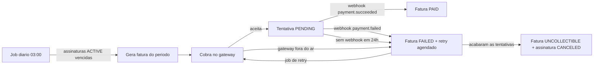

# Billing de assinaturas

API de cobranca recorrente: planos, assinaturas, faturas geradas por um job agendado, resultado do pagamento por **webhook** assinado e **retry** automatico quando a cobranca falha.

Stack: Java 17, Spring Boot 3.5, Spring Data JPA, PostgreSQL, Flyway, Testcontainers, Docker Compose.

## Como funciona



### Estados

| Assinatura | Significado |
|---|---|
| `ACTIVE` | Em dia. Entra no ciclo de cobranca. |
| `PAST_DUE` | Uma fatura falhou e ainda ha retries. Nao gera fatura nova ate regularizar. |
| `CANCELED` | Cancelada pelo cliente ou por falta de pagamento. |

| Fatura | Significado |
|---|---|
| `OPEN` | Gerada, aguardando cobranca ou resultado do gateway. |
| `PAID` | Paga. |
| `FAILED` | Ultima tentativa falhou, retry agendado em `nextRetryAt`. |
| `UNCOLLECTIBLE` | Sem mais tentativas. |

### Cobranca recorrente (job agendado)

- `BillingJobs.billingCycle` roda todo dia as 03:00 (`billing.jobs.cycle-cron`) e cobra toda assinatura `ACTIVE` com `nextBillingDate <= hoje`.
- Ao gerar a fatura, a data da proxima cobranca ja avanca (mensal ou anual). Rodar o job duas vezes no mesmo dia nao cobra duas vezes.
- Se dois servidores rodarem o job ao mesmo tempo, a constraint `UNIQUE (subscription_id, period_start)` impede a fatura duplicada. Um erro numa assinatura nao derruba o ciclo das outras.
- Ao assinar (`POST /subscriptions`), a primeira fatura e cobrada na hora.

### Cancelamento

`POST /subscriptions/{id}/cancel` (pode repetir, cancelar duas vezes nao e erro):

- fatura **paga** nao muda e a assinatura nao gera mais faturas;
- fatura **em aberto ou que falhou** e encerrada na hora (`UNCOLLECTIBLE`, motivo "Assinatura cancelada"), para ninguem cobrar o cliente depois;
- se ja existe uma cobranca **enviada ao gateway esperando resposta**, a fatura fica como esta: se o pagamento for aprovado o webhook ainda o registra (o dinheiro entrou) e a assinatura segue cancelada.

### Dia de cobranca em meses de tamanhos diferentes

A data da proxima cobranca usa o dia em que a assinatura comecou como referencia. Quem comecou no dia 31 paga 28/02, 31/03, 30/04, 31/05 (e nao 28 para sempre); quem comecou em 29/02 volta ao 29/02 no proximo ano bissexto.

### Webhooks de pagamento

O gateway cobra de forma assincrona e avisa o resultado em `POST /webhooks/payments`.

- **Assinatura**: o header `X-Signature: sha256=<hmac>` e conferido (HMAC-SHA256 do corpo cru com um segredo, comparacao em tempo constante). Sem assinatura valida: 401.
- **Idempotencia**: cada evento tem um `eventId` guardado em `webhook_events` (PK). O gateway reenvia o mesmo evento se nao receber 2xx, entao eventos repetidos, inclusive ao mesmo tempo, sao processados uma vez so e respondem `DUPLICATE`.
- O registro do evento e o efeito na fatura estao na mesma transacao: se o processamento falha, o evento nao fica gravado e o reenvio funciona.
- **Cobranca desconhecida** (o webhook chegou antes de gravarmos o id da cobranca): responde 404 para o gateway tentar de novo, sem gravar o evento.
- Se um `payment.succeeded` chegar depois de a tentativa ter sido dada como falha por timeout, o pagamento e registrado mesmo assim (o dinheiro entrou).

### Retry

Configuravel em `application.yml`:

```yaml
billing:
  retry:
    delays-hours: 24,72,120   # 4 tentativas no total
    pending-timeout: 24h      # cobranca sem webhook vira falha
```

| Tentativa | Se falhar |
|---|---|
| 1 | tenta de novo em 24h |
| 2 | tenta de novo em 72h |
| 3 | tenta de novo em 120h |
| 4 | fatura `UNCOLLECTIBLE`, assinatura `CANCELED` |

- Enquanto uma cobranca esta `PENDING` esperando o webhook, o retry nao cobra de novo (evita cobrar em duplicidade).
- A chamada ao gateway fica fora das transacoes do banco.
- Falha do gateway (fora do ar) nao vira erro 500 para o cliente: entra no mesmo fluxo de retry.
- Retry de fatura cuja assinatura foi cancelada nao cobra.

## Rodando

Precisa de Java 17, Maven e Docker.

```bash
docker compose up --build -d
./scripts/smoke-test.sh
```

O gateway e um `FakePaymentGateway`: aceita qualquer cobranca e devolve um `chargeId`. Voce simula o resultado mandando o webhook assinado:

```bash
# 1) cria plano, cliente e assinatura
curl -X POST localhost:8083/plans -H 'Content-Type: application/json' \
  -d '{"name":"Pro","price":49.90,"interval":"MONTHLY"}'
curl -X POST localhost:8083/customers -H 'Content-Type: application/json' \
  -d '{"name":"Ana","email":"ana@teste.com"}'
curl -X POST localhost:8083/subscriptions -H 'Content-Type: application/json' \
  -d '{"customerId":"<id-cliente>","planId":"<id-plano>","paymentToken":"tok_ok"}'

# 2) pega o chargeId da cobranca
curl localhost:8083/subscriptions/<id-assinatura>/invoices

# 3) envia o webhook assinado
BODY='{"eventId":"evt_1","type":"payment.succeeded","chargeId":"<chargeId>"}'
SIG=$(printf '%s' "$BODY" | openssl dgst -sha256 -hmac "segredo-local" | sed 's/^.* //')
curl -X POST localhost:8083/webhooks/payments -H 'Content-Type: application/json' \
  -H "X-Signature: sha256=$SIG" -d "$BODY"
```

Token `tok_gateway_down` simula o gateway fora do ar. Para disparar na mao o que os jobs fazem sozinhos: `POST /admin/billing/run`.

### Endpoints

O arquivo [`requests.http`](requests.http) tem o fluxo completo para rodar no IntelliJ ou no VS Code.

| Metodo | Rota |
|---|---|
| POST / GET | `/plans` |
| POST | `/customers` |
| GET | `/customers/{id}` |
| POST | `/subscriptions` |
| GET | `/subscriptions/{id}` |
| POST | `/subscriptions/{id}/cancel` (idempotente) |
| GET | `/subscriptions/{id}/invoices` (com as tentativas de cobranca) |
| GET | `/customers/{id}/invoices?page=&size=` (historico do cliente, todas as assinaturas, paginado) |
| POST | `/webhooks/payments` |
| POST | `/admin/billing/run` |
| GET | `/actuator/health` |

## Variaveis de ambiente

| Variavel | Padrao | Para que serve |
|---|---|---|
| `DB_URL` | monta a partir das tres abaixo | URL JDBC completa (se definida, ignora `DB_HOST`, `DB_PORT` e `DB_NAME`) |
| `DB_HOST` / `DB_PORT` / `DB_NAME` | `localhost` / `5435` / `billing` | Onde esta o Postgres |
| `DB_USER` / `DB_PASSWORD` | `billing` / `billing` | Credenciais do banco |
| `WEBHOOK_SECRET` | valor de desenvolvimento | Segredo da assinatura dos webhooks. **Troque em producao** |

## Deploy

Existe um `render.yaml` (Blueprint do Render) com a API em Docker e um Postgres gratuito, mas **ainda nao publiquei nem testei no Render**, entao nao ha link de demo. O banco gratuito do Render expira depois de um tempo, serve para demonstracao.

## Testes

```bash
mvn verify
```

70 testes. Os de integracao usam Testcontainers (Postgres real), entao o Docker precisa estar rodando. O gateway e mockado e o relogio e controlado pelo teste, para simular os dias passando.

- **Unitarios**: politica de retry, regras de fatura e assinatura, assinatura HMAC (adulterada, outro segredo, ausente).
- **Ciclo**: cobra ao assinar; segundo ciclo no mesmo dia nao cobra; cobra o proximo periodo na data certa; ignora canceladas e `PAST_DUE`; 4 instancias do job ao mesmo tempo geram uma fatura so.
- **Retry**: gateway fora do ar agenda retry; retry so na hora certa; 4 falhas cancelam a assinatura; nao cobra com tentativa pendente; timeout de cobranca sem webhook; assinatura cancelada nao e cobrada.
- **Webhook**: assinatura invalida, evento duplicado, 8 envios simultaneos do mesmo evento, cobranca desconhecida, tipo nao tratado, payload invalido, sucesso tardio depois do timeout, segundo pagamento da mesma fatura.
- **API**: fluxo completo, validacoes, 404/409.

## Limitacoes conhecidas

- **Job em varias instancias**: protegido pela constraint do banco, mas sem lock distribuido (o ShedLock evitaria o trabalho repetido).
- **Gateway real**: so existe o fake. Trocar significa implementar a interface `PaymentGateway`.
- **Sem autenticacao** nas APIs, incluindo `/admin`.
- **Sem prorrata**, troca de plano, cupons ou impostos.
- **Cobranca em duplicidade** (pagamento aprovado depois do timeout e do retry) e detectada e logada como alerta, mas o estorno e manual.
